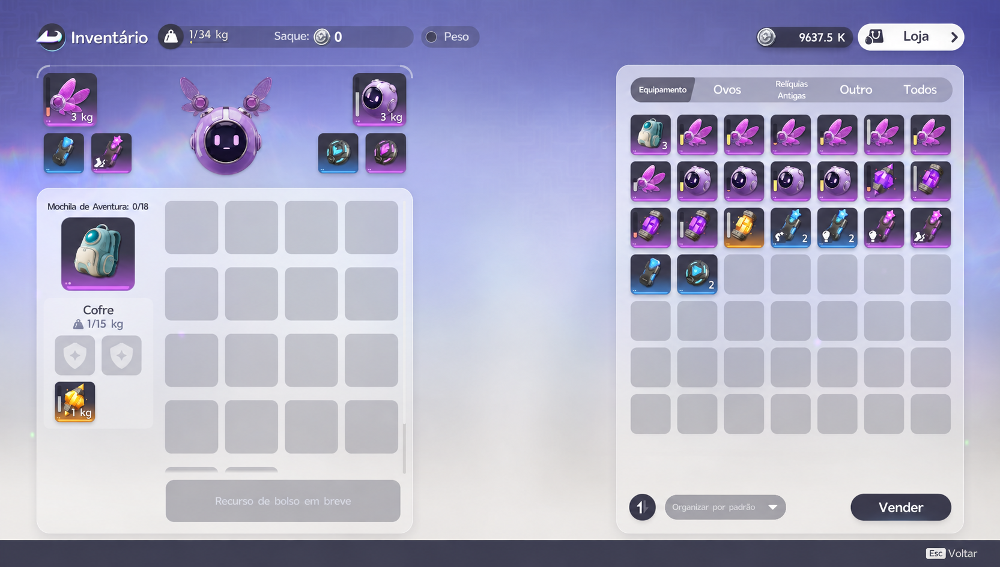
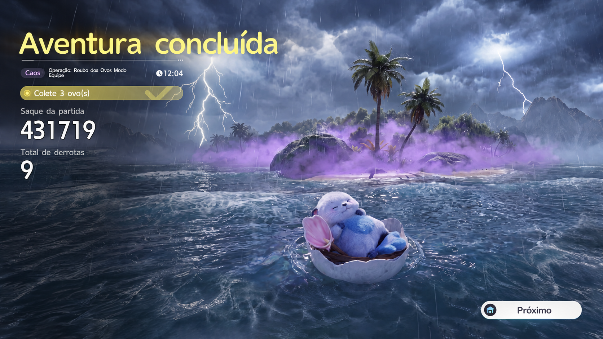
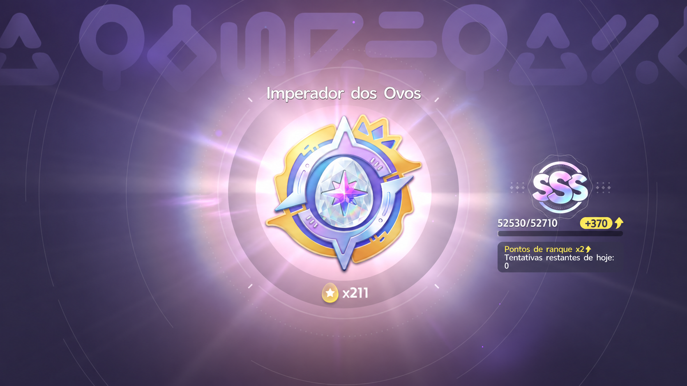
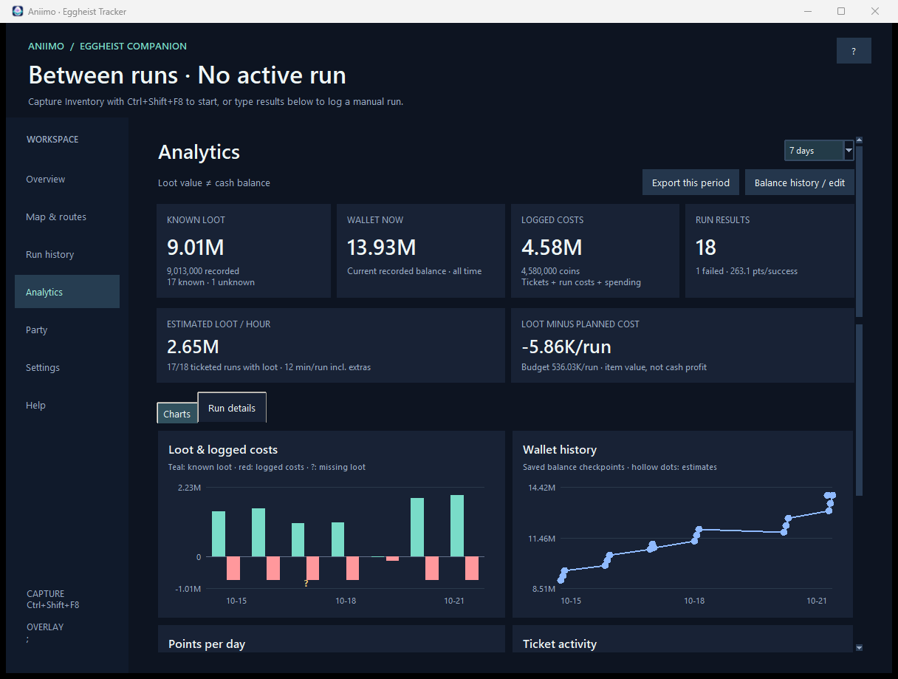
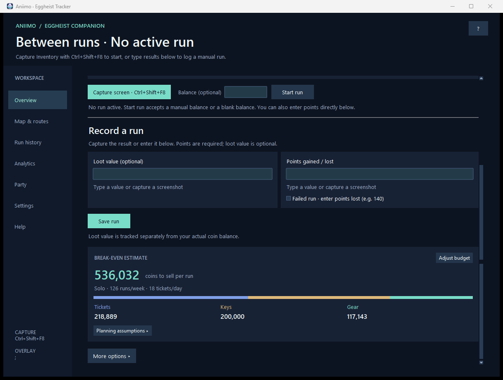

<div align="center">
  
  <h1>Aniimo Eggheist Tracker</h1>
  <p>Track your runs. Plan your rank goal. Find your way through Lost Sanctum.</p>
  <p>
    <a href="https://github.com/CoreosG/aniimo-tracker/releases/latest"></a>
    
    
  </p>
  <p><b><a href="https://github.com/CoreosG/aniimo-tracker/releases/latest">Download for Windows</a></b> · <a href="docs/USER_GUIDE.md">User guide</a> · <a href="server/README.md">Self-host a party server</a> · <a href="https://github.com/CoreosG/aniimo-tracker/issues">Report an issue</a></p>
</div>

---

## Get started

1. Download **AniimoTracker.exe** from the [latest release](https://github.com/CoreosG/aniimo-tracker/releases/latest) and open it. **No Python required.**
2. Follow the tutorial, enter your own current stats, and select your game monitor. Reopen the tutorial anytime with **?**.
3. In **Map & routes**, click **Download map pack** once. The app downloads the maps directly from AniimoTools and MOANIIMO.

**Updating?** Close the older tracker and open the new executable. Your history and settings stay in `%LOCALAPPDATA%/AniimoTracker`. Check for updates in **Settings → Storage & updates**.

## One shortcut, the right reading

| In the game | Press | What happens |
| :--- | :---: | :--- |
| Inventory, after shopping | **Ctrl + Shift + F8** | Start a run and read your balance |
| Loot result | **Ctrl + Shift + F8** | Record the extracted loot value |
| Egg Heist result | **Ctrl + Shift + F8** | Read points gained or lost |
| Results ready | **Ctrl + Shift + F9** | Save the run; loot is optional |
| During navigation | **M** | Identify the map from the game’s full map |
| During navigation | **;** | Show or hide the overlay |

All shortcuts are customizable. You can also start without a balance, enter a run manually, record only points, or use **map-only tracking**.

<details>
<summary><b>See the capture screens</b></summary>
<br>
<p align="center">
  
  
  
</p>
These are anonymized tutorial examples. Original player screenshots are not distributed.
</details>

## What you can do

| Track and plan | Navigate and play together |
| :--- | :--- |
| Editable runs, failures, paid and free tickets | All 21 layouts across four difficulties |
| Rank, ticket and remaining-playtime forecasts | Routes from both entrances; preferred exits |
| Key, gear and daily ticket break-even budgets | Key doors, eggs, rich rooms or trials |
| Loot, wallet, points and ticket graphs | Optional room icons, monsters and legend |
| Estimated loot/hour, sortable run details and filtered CSV export | Low CPU position updates and cached minimap detection |
| Edit historical balance checkpoints to fix outliers | Three-player parties with shared layouts and positions |
| Keep screenshots for the latest 30 runs, or choose a limit | Movable, click-through overlay with live display previews |

**Loot value and wallet balance are separate.** Unsold items do not add cash. Inventory captures record your wallet after sales and shopping. Failed runs affect progression but stay out of the successful-run points average.

### New in 0.3

The break-even card shows one sales target per run, with a colored ticket/key/gear breakdown. Assumptions stay collapsed until you need them. Analytics adds Today and 90-day filters, per-run comparisons, editing and CSV export. Map controls are grouped into **Route**, **Icons**, **Overlay** and **Tools**.

**Using a slower PC?** Choose **Map & routes → Overlay → Position updates → Low CPU (1.5s)**. Map identification and OCR work locally in background workers. Position tracking reuses the detected minimap area, while keeping the same geometric checks. See [performance notes](docs/PERFORMANCE.md) for measurements and limits.

[What changed in 0.3.0 →](docs/CHANGELOG.md)

<details>
<summary><b>See the new analytics and budget</b></summary>
<p>These previews use invented demo data.</p>


</details>

## Party navigation

Open **Party**, choose a username, then create a party or join an eight-character code. Up to three players share map identification and circular position markers through the default relay at **eggheist.banneret.app**. A custom server can be selected instead.

Any member can start a **New shared run**; the host controls difficulty. A confirmed map in a new shared run can warn about an unfinished local run, even when the layout repeats. **Warn about unfinished runs** is optional, and map-only users do not receive ledger warnings. Navigation advances without saving or discarding anyone’s unfinished results.

[Party usage and privacy →](docs/USER_GUIDE.md#party-navigation) · [Self-hosting →](server/README.md) · [Capacity measurements →](server/CAPACITY.md)

## Your data stays yours

Screenshots, OCR, balances and run history stay on your PC. A party relay receives only the chosen username, shared-run/map information and map coordinates. Its party state is held in memory.

Back up `%LOCALAPPDATA%/AniimoTracker` to preserve your data. The public executable excludes downloaded map art/data and personal databases. See the [user guide](docs/USER_GUIDE.md#local-data-and-privacy) for details.

## Inside the repository

```text
assets/       Recognition references, branding and anonymized tutorial examples
src/          Desktop app, ledger, OCR, map recognition and party communication
tests/        Ledger, vision, navigation and desktop regression tests
docs/         User guide, development and architecture notes
packaging/    Windows executable specification
scripts/      Source setup, launch and build helpers
server/       Lightweight relay deployment and load-test tooling
```

[Run from source, test and build →](docs/DEVELOPMENT.md) · [Architecture →](docs/ARCHITECTURE.md) · [Contributing →](CONTRIBUTING.md)

## Credits

The map features use resources downloaded directly from **[AniimoTools — Lost Sanctum](https://aniimotools.dev/map/lost-sanctum/)** and **[MOANIIMO — Sanctum finder](https://aniimo.kr/en/palace-finder)**. Please visit and support the original projects. Aniimo and its game content belong to **Pawprint Studio / FunPlus**.

This is an unofficial fan project. Third-party content retains its owners’ rights; credit does not grant redistribution rights. See [third-party notices](THIRD_PARTY_NOTICES.md). The original tracker source is public for inspection and feedback; an open-source license has not yet been selected.
